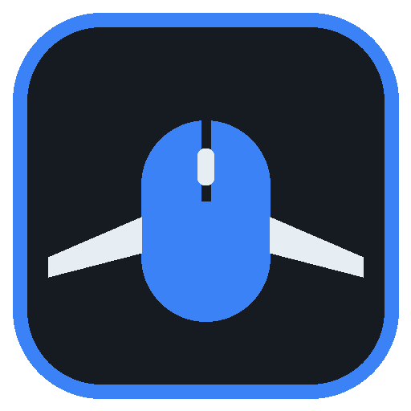
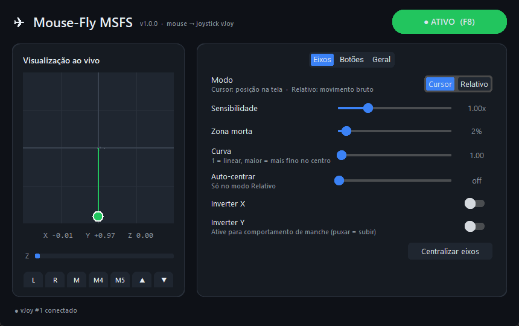

# Mouse-Fly MSFS



Transforma o mouse em um joystick virtual (vJoy) para usar no **Microsoft Flight Simulator 2020/2024**:

- **Eixo X/Y**: movimento do mouse (aileron / profundor)
- **Botões 1–5**: clique esquerdo, direito, clique do scroll, **Mouse 4** e **Mouse 5** (laterais)
- **Botões 6/7**: scroll para cima / para baixo (um pressionamento por "clique" da rodinha)
- **Eixo Z** (opcional): scroll controla um eixo, útil como throttle
- Interface simples com visualização ao vivo dos eixos e botões
- Tecla global para ligar/desligar (padrão **F8**), funciona com o simulador em foco



## Requisitos

- Windows 10/11 64-bit
- [vJoy](https://github.com/BrunnerInnovation/vJoy/releases) instalado

### Configurar o vJoy

Abra **Configure vJoy** e, no dispositivo 1 (ou outro), deixe ativados:

- Eixos **X**, **Y** (e **Z** se quiser o scroll como throttle)
- **Número de botões: 7** ou mais

## Uso

1. Baixe o `Mouse-Fly-MSFS.exe` em [Releases](../../releases) e execute.
2. Pressione **F8** (ou clique no botão do topo) para ativar.
3. No MSFS, em **Opções → Controles**, selecione o dispositivo **vJoy Device** e associe:
   - Eixo X → Aileron, Eixo Y → Elevator
   - Botões 1–7 às funções que quiser
4. Pressione **F8** para desativar quando precisar usar o mouse normalmente.

### Modos de eixo

| Modo | Como funciona |
|------|---------------|
| **Cursor** | Posição do cursor no monitor atual. Centro da tela = manche centralizado. |
| **Relativo** | Usa o movimento bruto do mouse (Raw Input), sem depender da borda da tela. "Auto-centrar" faz o manche voltar ao centro sozinho. |

Ajustes: sensibilidade, zona morta, curva (precisão perto do centro), inverter X/Y.

**Bloquear cliques no Windows**: enquanto ativo, os botões e o scroll vão só para o joystick (não clicam na tela). Use a tecla de atalho para desativar.

As configurações ficam em `%APPDATA%\MouseFlyMSFS\config.json`.

## Rodar pelo código

```bash
python -m venv .venv
.venv\Scripts\pip install -r requirements.txt
.venv\Scripts\python main.py
```

## Gerar o executável

```bash
build.bat
```

O `.exe` sai em `dist\Mouse-Fly-MSFS.exe`.

## Observações

- A `vJoyInterface.dll` é carregada da pasta de instalação do vJoy, para sempre bater com a versão do driver.
- Alguns antivírus acusam falso positivo em executáveis do PyInstaller que leem o mouse globalmente. O código-fonte está todo aqui.
- Se o MSFS estiver rodando como administrador, rode o Mouse-Fly também como administrador.

## Licença

MIT
